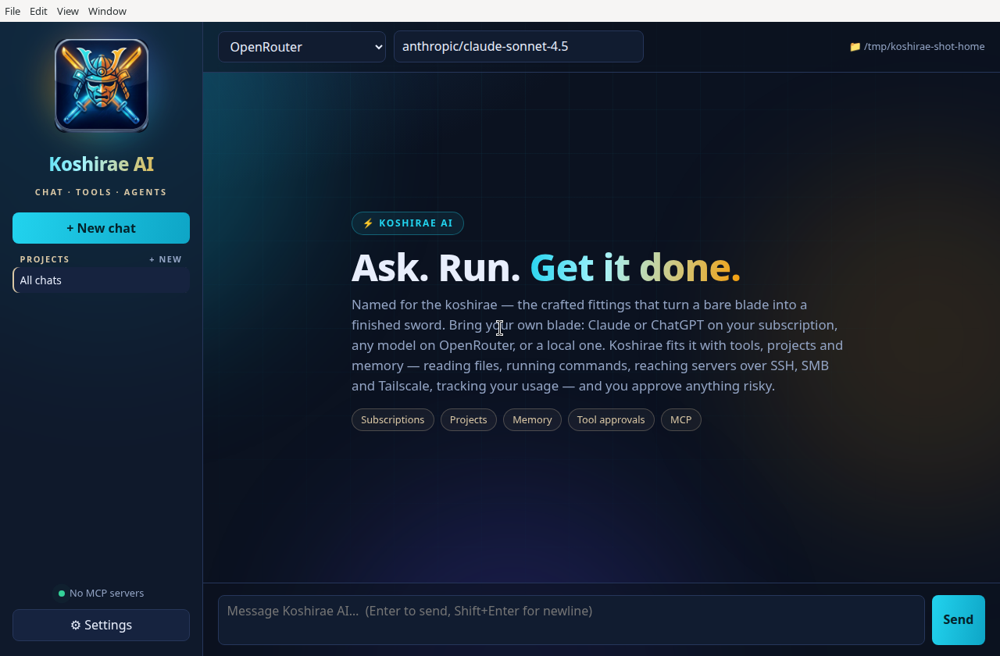
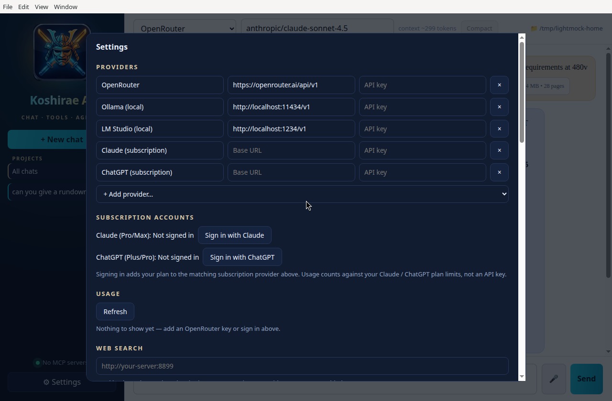

<p align="center"></p>

# Koshirae AI

Desktop AI chat + agent harness for macOS and Linux (Electron, React, TypeScript).

## Why "Koshirae"?

Koshirae (拵え) are the mountings of a Japanese sword: the scabbard, hilt, guard and fittings, crafted to make a bare blade into a complete, usable weapon. Here the blade is whichever AI model you bring. Koshirae AI is everything fitted around it — tools, projects, memory, approvals and usage tracking — so the blade can do real work on your machine.

## Screenshots


*The main window — projects and chats in the sidebar, provider and model up top, and the approvals-first agent chat.*


*Settings — providers, subscription sign-ins (Claude Pro/Max and ChatGPT Plus/Pro), per-source usage, and the chat model picker.*

- **Providers**: OpenRouter, OpenAI, Anthropic (OpenAI-compat), Ollama, LM Studio, or any OpenAI-compatible URL. Streaming chat, model picker, saved conversations.
- **Voice dictation** 🎤: click the mic in the composer and talk — transcription runs **entirely on-device** with Whisper (large-v3-turbo; the engine comes from `brew install whisper-cpp` and the ~1.6 GB model downloads once from Settings → Voice dictation). An optional cleanup pass (a free OpenRouter model by default; point it at the Ollama / LM Studio provider to keep it fully local) strips fillers and fixes punctuation, and the text lands in the composer for review — never auto-sent, and the audio itself never leaves the machine.
- **Agent tools** (with per-category approval: read / write / exec / mcp): local files, shell, SSH (`ssh_*`, uses your keys/agent/`~/.ssh/config`, works with Tailscale hostnames), SMB (`smbclient`, or use mounted shares), Tailscale status, HTTP fetch.
- **MCP**: stdio or streamable-HTTP servers, configured in Settings as JSON.
- API keys / SMB passwords are encrypted with Electron `safeStorage` when available.

## Run

```bash
npm install
npm run dev
```

## Package

```bash
npm run dist   # dmg on macOS, AppImage + deb on Linux
```

## MCP example (Settings → MCP servers)

```json
[{"name":"fs","command":"npx","args":["-y","@modelcontextprotocol/server-filesystem","/home/me"]}]
```
